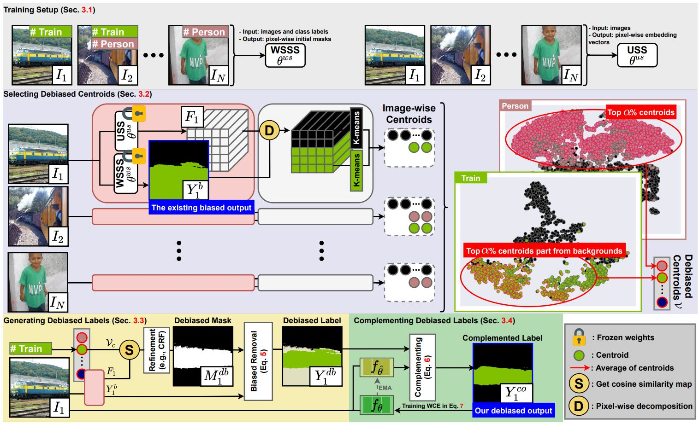

[](https://paperswithcode.com/sota/weakly-supervised-semantic-segmentation-on-4?p=mars-model-agnostic-biased-object-removal)
[](https://paperswithcode.com/sota/weakly-supervised-semantic-segmentation-on-1?p=mars-model-agnostic-biased-object-removal)
[](https://paperswithcode.com/sota/weakly-supervised-semantic-segmentation-on?p=mars-model-agnostic-biased-object-removal)

# MARS: Model-agnostic Biased Object Removal without Additional Supervision for Weakly-Supervised Semantic Segmentation
This repository is the official implementation of "MARS: Model-agnostic Biased Object Removal without Additional Supervision
for Weakly-Supervised Semantic Segmentation". Please feel free to reach out for any questions or discussions.

[[paper]](https://openaccess.thecvf.com/content/ICCV2023/papers/Jo_MARS_Model-agnostic_Biased_Object_Removal_without_Additional_Supervision_for_Weakly-Supervised_ICCV_2023_paper.pdf) [[supp]](https://openaccess.thecvf.com/content/ICCV2023/supplemental/Jo_MARS_Model-agnostic_Biased_ICCV_2023_supplemental.pdf) [[arXiv]](https://arxiv.org/abs/2304.09913)

# Update
[07/25/2026] Released the complete implementation of MARS (preprocessing, training, and evaluation).

> We sincerely apologize for the long delay in releasing the code, which was due to company commitments, and we thank everyone for their patience. We will continue supporting this work so that its ideas can better contribute to the community and to future research.

[07/14/2023] Our MARS has been accepted to ICCV 2023. 🔥🔥🔥

[04/25/2023] Released initial commits.

### Abstract
Weakly-supervised semantic segmentation aims to reduce labeling costs by training semantic segmentation models using weak supervision, such as image-level class labels. However, most approaches struggle to produce accurate localization maps and suffer from false predictions in class-related backgrounds (\emph{i.e.}, biased objects), such as detecting a railroad with the train class. Recent methods that remove biased objects require additional supervision for manually identifying biased objects for each problematic class and collecting their datasets by reviewing predictions, limiting their applicability to the real-world dataset with multiple labels and complex relationships for biasing. Following the first observation that biased features can be separated and eliminated by matching biased objects with backgrounds in the same dataset, we propose a fully-automatic/model-agnostic biased removal framework called MARS (\textbf{M}odel-\textbf{A}gnostic biased object \textbf{R}emoval without additional \textbf{S}upervision), which utilizes semantically consistent features of an unsupervised technique to eliminate biased objects in pseudo labels. Surprisingly, we show that MARS achieves new state-of-the-art results on two popular benchmarks, PASCAL VOC 2012 (val: 77.7\%, test: 77.2\%) and MS COCO 2014 (val: 49.4\%), by consistently improving the performance of various WSSS models by at least 30\% without additional supervision.



# Citation
- Please cite our paper if the code is helpful to your research.

```
@InProceedings{Jo_2023_ICCV,
    author    = {Jo, Sanghyun and Yu, In-Jae and Kim, Kyungsu},
    title     = {MARS: Model-agnostic Biased Object Removal without Additional Supervision for Weakly-Supervised Semantic Segmentation},
    booktitle = {Proceedings of the IEEE/CVF International Conference on Computer Vision (ICCV)},
    month     = {October},
    year      = {2023},
    pages     = {614-623}
}
```

# Setup
Setting up for this project involves installing dependencies and preparing datasets. The code is tested on Ubuntu 20.04 with NVIDIA GPUs and CUDA installed. 

### Installing dependencies
To install all dependencies, please run the following:
```bash
python3 -m pip install git+https://github.com/lucasb-eyer/pydensecrf.git
python3 -m pip install -r requirements.txt
```

or reproduce our results using docker.
```bash
docker build -t mars_pytorch:v1.8.1 .
docker run \
    --gpus all \
    -it \
    --rm \
    --shm-size 64G \
    --volume="$(pwd):$(pwd)" \
    --workdir="$(pwd)" \
    mars_pytorch:v1.8.1
```

### Preparing datasets

Please download following VOC and COCO datasets. Each dataset has a different directory structure. Therefore, we modify directory structures of all datasets for a comfortable implementation. 

> ##### 1. PASCAL VOC 2012
> Download PASCAL VOC 2012 dataset from [[Google Drive](https://drive.google.com/file/d/1dkwHjd-r4Xe4ap0PWNMn0GRnekIrEKyQ/view?usp=sharing)].

> ##### 2. MS COCO 2014
> Download MS COCO 2014 dataset from [[Google Drive](https://drive.google.com/file/d/1hzpnPJws2Fsc4LjLnuxJpaxtCLY9ltlQ/view?usp=sharing)].

Create a directory "../VOC2012/" for storing the dataset and appropriately place each dataset to have the following directory structure.
```
    ../                               # parent directory
    ├── ./                            # current (project) directory
    │   ├── core/                     # (dir.) implementation of MARS
    │   ├── data/                     # (dir.) information per dataset (including class names and the number of classes)
    │   ├── tools/                    # (dir.) helper functions
    │   ├── README.md                 # intstruction for a reproduction
    │   └── ... some python files ...
    |
    ├── VOC2012/                      # PASCAL VOC 2012
    │   ├── train/              
    │   │   ├── image/     
    │   │   ├── mask/        
    │   │   └── xml/        
    │   ├── train_aug/
    │   │   ├── image/     
    │   │   ├── mask/        
    │   │   ├── xml/   
    |   |   └── RS+EPM/               # pseudo labels produced by the WSSS method
    │   ├── validation/
    │   │   ├── image/     
    │   │   ├── mask/        
    │   │   └── xml/   
    │   └── test/
    │       └── image/
    |
    └── COCO2014/                     # MS COCO 2014
        ├── train/              
        │   ├── image/     
        │   ├── mask/        
        │   ├── xml/
        |   └── RS+EPM/               # pseudo labels produced by the WSSS method
        └── validation/
            ├── image/     
            ├── mask/        
            └── xml/
```

# Preprocessing

The overall code is based on RS+EPM (WSSS) and STEGO (USS), which showed the highest performance in our experiments. To reproduce our results quickly, we share [debiased_labels.zip](https://drive.google.com/file/d/1Qwptwwu9_GdHtoRT7AqlD3om5-PWriav/view?usp=share_link).

### 1. Training USS and WSSS methods
- **[For USS]** Please download the trained STEGO weights from scratch on the PASCAL VOC 2012 dataset ([stego_voc.ckpt](https://drive.google.com/file/d/1Qwptwwu9_GdHtoRT7AqlD3om5-PWriav/view?usp=share_link)).
We follow the official [github](https://github.com/mhamilton723/STEGO) to train STEGO from scratch on PASCAL VOC 2012 and MS COCO 2014 datasets (./weights/stego_voc.ckpt).
- **[For WSSS]** Please download and prepare pseudo labels of RS+EPM [pseudo_labels.zip](https://drive.google.com/file/d/1MwqpQQrD7ANOI3x-AlCoAWFQLnnpcU2W/view?usp=sharing). You can replace RS+EPM with other WSSS methods based on the shared WSSS labels (../VOC2012/train_aug/RS+EPM/).

### 2. Generating Debiased Labels
Below lines are commands to remove biased pixels in pseudo labels.
```bash
# 1. Extract USS features.
python3 extract_features_using_USS.py \
--gpus 0 --root_dir ../VOC2012/ --domain train_aug \
--uss STEGO --weight_path ./weights/stego_voc.ckpt

# 2. Separate target and biased centroids for each class.
python3 separate_target_and_biased_objects.py \
--cpus 8 --dataset VOC --root_dir ../VOC2012/ --domain train_aug \
--wsss RS+EPM --uss STEGO --K_bg 2 --K_fg 2

# 3. Generate debiased masks after selecting debiased centroids.
python3 generate_debiased_masks.py \
--cpus 8 --dataset VOC --root_dir ../VOC2012/ --domain train_aug \
--wsss RS+EPM --uss STEGO --ours "RS+EPM@STEGO@K_bg=2@K_fg=2" --alpha 0.40

# 4. Refine debiased masks to binarize.
python3 refine_debiased_masks.py \
--cpus 8 --dataset VOC --root_dir ../VOC2012/ --domain train_aug \
--tag "RS+EPM@STEGO@K_bg=2@K_fg=2@alpha(0.40)"

# 5. Generate debiased labels by applying debiased masks in pseudo labels.
python3 generate_debiased_labels.py \
--root_dir ../VOC2012/ --domain train_aug \
--wsss "RS+EPM" --ours "RS+EPM@STEGO@K_bg=2@K_fg=2@alpha(0.40)@Mask"
```

# Training
Train the segmentation network by complementing debiased labels.
```bash
python3 train_mars.py \
--gpus 0 --dataset VOC --root_dir ../VOC2012/ --train_domain train_aug \
--backbone resnet101 --decoder deeplabv3+ \
--pseudo_tag "RS+EPM@STEGO@K_bg=2@K_fg=2@alpha(0.40)@MARS" \
--tag "ResNet-101@VOC@RS+EPM_with_MARS"
```

# Evaluation
Release our VOC/COCO weights and official results (anonymous links).

| Method | Backbone | Pretrained weight            | VOC val | VOC test | COCO val |
|:-----:|:------------:|:----------------------------:|:-------:|:--------:|:--------:|
| MARS | ResNet-101 | [VOC & COCO](https://drive.google.com/file/d/1Qwptwwu9_GdHtoRT7AqlD3om5-PWriav/view?usp=share_link) | 77.7% [link](http://host.robots.ox.ac.uk:8080/anonymous/JWM7SJ.html) | 77.2% [link](http://host.robots.ox.ac.uk:8080/anonymous/XEAPLX.html) | 49.4% |

Below lines are testing commands to reproduce our results.
```bash
# 1. Generate initial predictions.
python3 infer_seg.py \
--gpus 0 --dataset VOC --root_dir ../VOC2012/ --domain validation \
--backbone resnet101 --decoder deeplabv3+ --tag "ResNet-101@VOC@RS+EPM_with_MARS"

# 2. Refine initial predictions.
python3 apply_crf.py \
--cpus 8 --dataset VOC --root_dir ../VOC2012/ --domain validation \
--tag "ResNet-101@VOC@RS+EPM_with_MARS"

# 3. Calculate the mIoU.
python3 evaluate.py \
--dataset VOC --root_dir ../VOC2012/ --domain validation \
--tag "ResNet-101@VOC@RS+EPM_with_MARS"
```

# Acknowledgment
- This code is heavily borrowed from [RS+EPM](https://github.com/shjo-april/recurseed_and_edgepredictmix).
